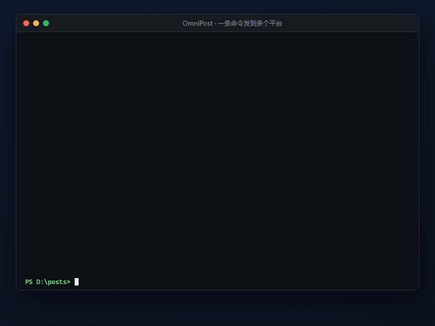

# OmniPost Skill

**让 Claude Code / OpenClaw / Codex 等 AI 代理，用一条命令把写好的内容发到 40 多个平台。**

[English](./README.en.md) · [SKILL.md](./skills/omnipost/SKILL.md) · [接入各 agent](./docs/connect.md) · [FAQ](./docs/faq.md) · [下载 OmniPost](https://omnigoai.com/zh/download/omnipost/)

- **AI 写完，一条命令发出去**：知乎、CSDN、公众号、小红书、B站、抖音、视频号、Dev.to、Mastodon……一个入口，不用一个平台配一个 MCP。
- **账号留在你自己的电脑上**：登录态存在本机独立会话分区，发出去的请求来自你自己的浏览器会话，不经过任何云端中转。
- **默认进草稿箱，发布那一下你来点**：掉线提前提醒，因登录失效漏发的内容在重登后自动补发。

OmniPost 是「手」，不是「脑」：它不含模型、不写内容、不判断内容、不自动互动。写什么、发哪里由你的 agent 决定。

## 30 秒接入

1. 装 [OmniPost](https://omnigoai.com/zh/download/omnipost/)（Windows / macOS），打开后在应用里登录你要发的平台账号（扫码或账号密码，和你平时登录网页一样）。
2. 把本仓库的 `skills/omnipost/` 整个文件夹放进 agent 的 skills 目录：
   - Claude Code：`~/.claude/skills/omnipost/`（项目内用 `.claude/skills/omnipost/`）
   - OpenClaw：`~/.openclaw/skills/omnipost/`（或工作区的 `skills/omnipost/`）
   - 其它 agent：放进它的 skills 目录，或把 `SKILL.md` 内容作为系统提示喂给它
   - 想要 MCP 工具（可选）：`claude mcp add --transport sse omnipost http://127.0.0.1:8787/sse`
3. 对 agent 说：**「把这篇发到知乎、CSDN，公众号先进草稿箱。」**

更多客户端（Codex / Cursor / Cline / 任意 HTTP 调用）见 [docs/connect.md](./docs/connect.md)。

## 仓库里有什么

- `skills/omnipost/SKILL.md` —— 技能本体：如何找到本机 OmniPost、CLI 速查、44 个 MCP 工具与 CLI 命令对照、发布工作流、写法规格、运营巡检、约定。
- `skills/omnipost/rules/` —— **10 个中文平台的内容规则速查**（小红书、公众号、抖音、快手、视频号、B站、微博、百家号、头条号、知乎），每条红线附官方条款编号与来源链接。agent 发布前按平台先读，典型动作是删站外链接、去二维码、去联系方式。不用 OmniPost 也能用。
- `examples/` —— 可直接改的发布 JSON、定时 JSON、Bash / PowerShell 脚本。
- `docs/connect.md` —— 各 agent 接入方法；`docs/faq.md` —— 常见问题。

## 支持的平台（41 个）

- **中文图文**：CSDN、掘金、知乎、微信公众号、博客园、思否、开源中国、51CTO、慕课手记、人人都是产品经理、雪球、东方财富、豆瓣、头条号、搜狐号、百家号、微博
- **中文图文 + 视频**：小红书、B站、视频号、抖音、快手、微博、百家号、搜狐号
- **海外（官方 API）**：Dev.to、Hashnode、WordPress、Ghost、Mastodon、Pleroma、GoToSocial、Pixelfed、Bluesky、Threads、Reddit、LinkedIn、Lemmy、Micro.blog、Telegram、Discord、Slack、Matrix、Tumblr

每个平台能发什么（图文 / 视频）、正式发布必填什么、专属参数有哪些，`omnipost platforms` 或 MCP `list_platforms` 会返回机器可读的清单，agent 不用背。

## 和同类工具的关系

- **xiaohongshu-mcp / XiaohongshuSkills 等单平台 MCP**：它们一个平台一个 server，做得很深。OmniPost 是多平台的一个入口，小红书也在其中；要发多平台时不必逐个配。
- **Wechatsync（文章同步助手）**：浏览器扩展，免费开源，适合手动同步文章。OmniPost 是桌面应用，带 CLI / MCP 给 agent 调，带草稿、定时、多账号、登录态预警与补发。
- **PublishPort 等云中转方案**：请求经由云端 token 中转、按调用次数计费。OmniPost 不中转、不按次，登录态只在你本机。
- **蚁小二 / 易媒助手等矩阵工具**：面向人工运营的图形界面。OmniPost 面向 agent，内容由 agent 生成，OmniPost 只管发。

## 关于封号，说实话

自动化发布本身就有平台风控风险，小红书 2026 年 3 月的公告明确说 AI 托管发布和互动会被封禁。OmniPost **不做也不宣传「防封」**：

- 默认进草稿箱，正式发布由你决定；
- 不自动点赞、评论、回复、关注，不模拟真人行为；
- `rules/` 里按平台列出官方红线，agent 发前先读；
- 多账号、高频、同质内容是封号主因，请降频、改写、人工确认。

内容合规由你负责。

## 免费版与专业版

- **免费版**：8 个开发者平台（CSDN、掘金、知乎、博客园、思否、开源中国、51CTO、慕课手记）、3 个账号、每月 30 篇，永久免费。
- **专业版**：全部平台、50 个账号、每月 1000 篇、定时与错峰、自动发布、账户分组、MCP / CLI 自动化。¥39/月、¥99/季、¥299/年。装好后在应用内一键领 **7 天专业版试用**，不填卡。

## 想聊聊

我们正在找 **10 位用 Claude Code / OpenClaw / Codex 发内容的人**，聊 20 分钟你的发布流程（什么时候卡、怎么被封、还缺什么）。聊完送 3 个月专业版。开一个标题带「聊聊」的 issue 就行。

Bug、平台改版发不出去、想要的平台没有：直接开 issue。

## 许可

本仓库（Skill、规则速查、示例、文档）以 MIT 许可开源。OmniPost 桌面应用本身是免费 + 付费的闭源软件，由 [OmniGoAI](https://omnigoai.com) 开发。
